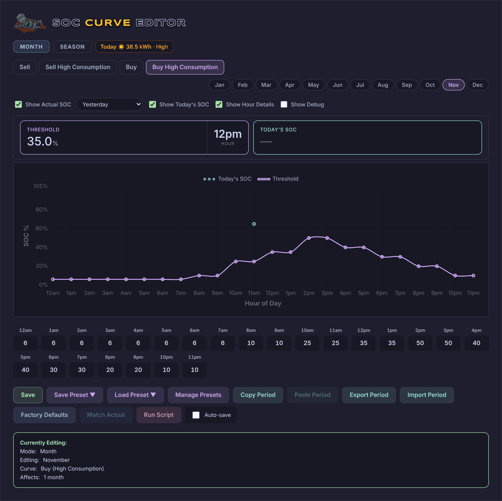
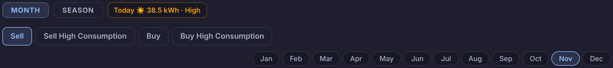
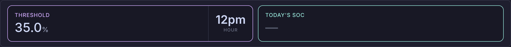
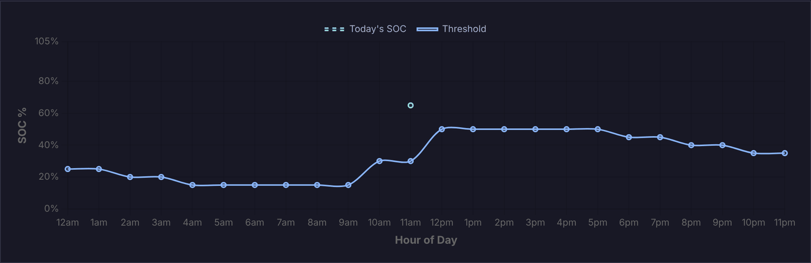
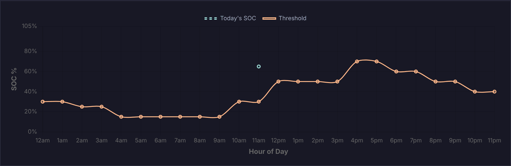
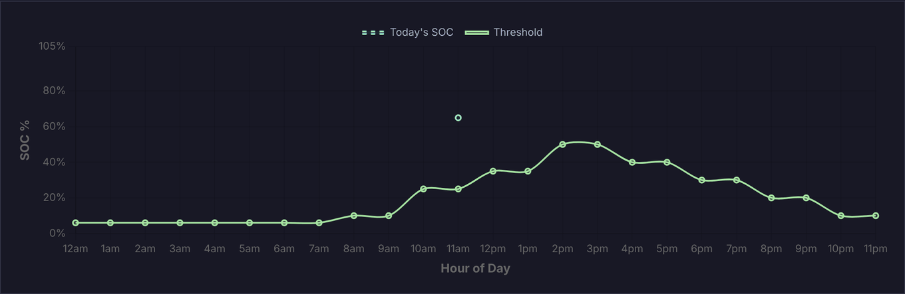
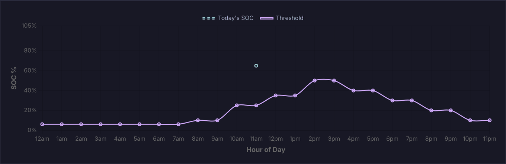
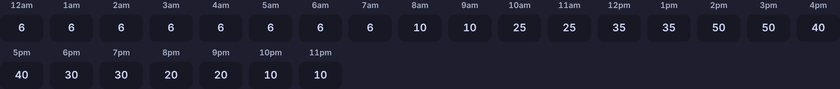
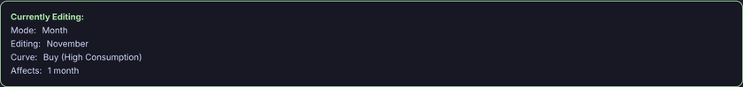

# Curvy

The **Curvy** view is the SOC curve editor. For each hour of each month it holds the battery levels (SOC %) Battman's engine works to: how full the battery must be before Battman sells, and how empty before it buys from the grid. Each comes in a normal version and one for times of high consumption. The prices that go with them are set on [Pricy](pricy.md).

While **Show help** is on (see [Showing or hiding the guide](../README.md#showing-or-hiding-the-guide)), a **Help** button at the top right of the view puts a "?" on each part of the editor. The "?" opens that part's summary from this page.

| Part | What it is for |
|---|---|
| [Period and curve](#edit) | **Month** or **Season**, today's solar forecast, and which curve and period you're editing. |
| [Chart options](#options) | Which extra lines the chart shows, the hour details, and the debug log. |
| [Hour details](#readouts) | The values at one hour: the curve, the battery's actual level, and what was happening then. |
| [Chart](#chart) | The curve you're editing, with the battery's actual levels over it. |
| [Hour values](#hours) | The curve's 24 values, one box per hour. |
| [Buttons](#buttons) | Save, presets, copy and paste, files, factory curves, Match Actual, Run Script and Auto-save. |
| [Currently Editing](#editing) | What you're editing and which months a change affects. |

## Period and curve

<!-- guide:summary id="curvy.edit" -->
Pick **Month** or **Season**, then one of the four curves and the month or season to edit. The editor opens on this month, on **Sell** from 5 pm until 10 pm and on **Buy** otherwise (the High Consumption one while the house is using more than the **Battman high consumption** helper). The badge beside **Season** is today's solar forecast.
<!-- /guide:summary -->

### The four curves

| Tab | What Battman does with it, hour by hour |
|---|---|
| **Sell** | Sells only while the battery is above this level and the feed-in price is at or above its sell price (see [Sell](settings.md#sell)). |
| **Sell High Consumption** | Used instead of **Sell** at needy times. |
| **Buy** | Charges from the grid while the battery is below this level and the buy price is at or below its buy price (see [Buy](settings.md#buy)). |
| **Buy High Consumption** | Used instead of **Buy** at needy times. |

Needy times are while the house is using a lot of power, or, between 10 am and 4 pm, when the solar forecast won't fill the battery: see [Needy curve triggers](settings.md#needy). Through each hour, the level Battman works to moves in a straight line towards the next hour's value.

### Month or season

- **Month**: you edit one month, with the tabs **Jan** to **Dec**.
- **Season**: Curvy asks first ("Switching to Season mode will group months together."), then gives each season's months the curves of its first month. Every change then goes to all three months. The seasons follow your Home Assistant location: south of the equator **Summer** is December to February, north of it June to August.
- Pressing **Month** goes back to this month. The months keep the curves Season gave them.

### Today badge

"Today ☀️ 38.5 kWh · High" is Solcast's forecast of today's solar (its cautious estimate, when Solcast gives the detailed forecast). **High** is 30 kWh or more, **Low** is 12 kWh or less, and **OK** is anything between. Without `sensor.solcast_pv_forecast_forecast_today` there's no badge.

## Chart options

<!-- guide:summary id="curvy.options" -->
Tick what the chart shows over the curve: the battery's level on past days (**Show Actual SOC**, with the days picked in the list beside it) and its level so far today (**Show Today's SOC**). **Show Hour Details** shows the tiles above the chart, and **Show Debug** a log of what the editor does.
<!-- /guide:summary -->

### What each option shows

| Option | Shows |
|---|---|
| **Show Actual SOC** | A red dashed line of the battery's level on the days picked in the list. **Match Actual** works from it. |
| **Show Today's SOC** | A teal dashed line of today's level, from the reading nearest the start of each hour, up to now. |
| **Show Hour Details** | The [hour details](#readouts) tiles. |
| **Show Debug** | A log box under the buttons, with **Clear**. |

### The days for Actual SOC

| Pick | The line is |
|---|---|
| **Yesterday** | The last reading in each hour of yesterday. |
| **Average (1 day)** to **Average (30 days)** | The average of the readings in each hour over that many days back from now. |
| **Specific Dates** | From the **Start:** and **End:** dates. One date gives the last reading in each hour; more than one, the average. |

## Hour details

<!-- guide:summary id="curvy.readouts" -->
Tiles with the values at one hour: **Threshold** (the curve you're editing), **Actual SOC** and **Today's SOC**. They show the current hour until you point at the chart or an hour box. Under each SOC is what was happening then: the battery mode, prices and solar.
<!-- /guide:summary -->

### What the tiles show

| Tile | Shows |
|---|---|
| **Threshold** | The curve's value at that hour, with the hour. |
| **Actual SOC** | The Actual SOC line at that hour. For **Yesterday** or a single date, under it are the battery mode then, the hour's average **FIT** and **Buy** prices in $, and the average solar power. For more days, the average solar power only. |
| **Today's SOC** | Today's line at that hour, then today's battery mode, prices and solar power for it, with Solcast's forecast solar. |

A value that isn't there shows as "—". The solar power is the Sigenergy plant's (`sigen_pv_power`); without it there's no solar.

## Chart

<!-- guide:summary id="curvy.chart" -->
The curve you're editing for the period shown, as SOC % across the hours of the day, in the curve's colour. The Actual SOC and Today's SOC lines sit over it. Point at an hour to see its details; press it to go to that hour's box.
<!-- /guide:summary -->

**Sell**: the curve in blue.

**Sell High Consumption**: the curve in orange.

**Buy**: the curve in green.

**Buy High Consumption**: the curve in purple.

### The lines

| Line | Shows |
|---|---|
| **Threshold**, solid | The curve you're editing, in its tab's colour. |
| **Actual SOC (…)**, red dashed | The battery's level on past days. The name says which, such as "Actual SOC (Yesterday)" or "Actual SOC (7-day avg)". |
| **Today's SOC**, teal dashed | The battery's level so far today. |

### Pointing and pressing

Pointing at an hour shows it in the [hour details](#readouts) and highlights its box. Pressing it scrolls to the box and puts the cursor in it. Pointing at an hour box shades its column on the chart.

## Hour values

<!-- guide:summary id="curvy.hours" -->
The curve's 24 values, one box per hour from **12am** to **11pm**, in SOC %. Type a value or use the arrows, and the chart follows at once. Battman gets the change when you press **Save**, or a second later with **Auto-save** on.
<!-- /guide:summary -->

### Values

Each box is the hour that starts at its time. Values are whole numbers from 0 to 100, and the arrows move in steps of 5. A value above 100 becomes 100; below 0 or empty becomes 0. In Season mode a change goes to all three months of the season.

## Buttons

<!-- guide:summary id="curvy.buttons" -->
**Save** sends all twelve months' curves to Battman. Presets, copy and paste, files, **Factory Defaults** and **Match Actual** change the period shown in the editor, and Battman gets those when you press **Save**. **Run Script** runs Battman's engine now.
<!-- /guide:summary -->

### What each button does

| Button | Does |
|---|---|
| **Save** | Sends all four curves of all twelve months to Battman. It says "Saved!" once Battman has them, or "Not saved: Battman didn't take it". |
| **Save Preset ▼** | Saves the four curves of the period shown as one of ten presets. This saves to Battman straight away. |
| **Load Preset ▼** | Puts a preset's four curves into the period shown. Each preset says "✓ Saved" or "Empty"; empty ones are dimmed. |
| **Manage Presets** | Names the presets: type the names, then **Save Names**. |
| **Copy Period** | Copies the four curves of the period shown. |
| **Paste Period** | Puts the copied curves into the period shown. It's greyed out until you copy. |
| **Export Period** | Downloads the four curves of the period shown as a file, `soc_curves_<period>_<date>.json`. |
| **Import Period** | Loads the four curves from an exported file into the period shown. |
| **Factory Defaults** | Puts Battman's factory curves into the period shown, all four. |
| **Match Actual** | Sets the curve shown to the **Actual SOC** line, in whole numbers, filling hours with no reading from the hours each side. It's greyed out until the Actual SOC line is shown. |
| **Run Script** | Runs the Battman engine (`script.battman_engine`) now. |
| **Auto-save** | Saves a second after each change to an hour value. |

Everything that replaces curves asks first. Messages show beside the title at the top.

### Presets

A preset holds all four curves for one period. The [Auto curve switcher](settings.md#auto-curve) picks from these presets when it's on. **Currently Editing** shows which preset a period came from.

### When the curves change elsewhere

If Battman's curves change while Curvy is open (the auto curve switcher, the month-end copy, or another browser), Curvy redraws with them. If you have changes you haven't saved, it keeps yours and says "The curves changed outside the editor — reload to see the new ones (your unsaved edits are kept)."

## Currently Editing

<!-- guide:summary id="curvy.editing" -->
What the editor is working on: **Month** or **Season**, the period, the curve, and which months a change affects. It also shows the preset the period came from, whether you've changed it since, and what's ready to paste.
<!-- /guide:summary -->

### What it shows

| Line | Shows |
|---|---|
| **Mode** | `Month`, or `Season` with "⚠️ Edits apply to all months in season". |
| **Editing** | The month, or the season with its months, such as `Summer (Dec-Feb)`. |
| **Curve** | `Sell (Normal)`, `Sell (High Consumption)`, `Buy (Normal)` or `Buy (High Consumption)`. |
| **Affects** | `1 month`, or the season's three months. |
| **Based on** | The preset last loaded into this period, with "✏️ modified" once you change an hour. Battman keeps this with the curves. |
| **Clipboard** | The copied period, "(ready to paste)". |
