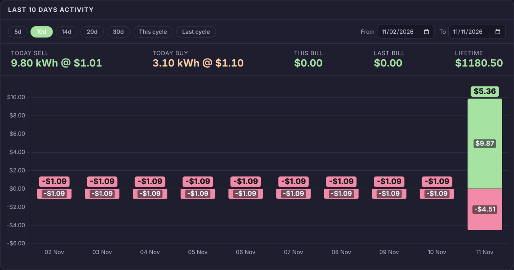
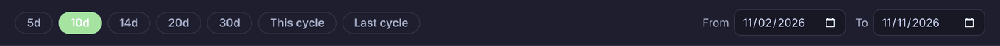
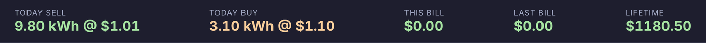
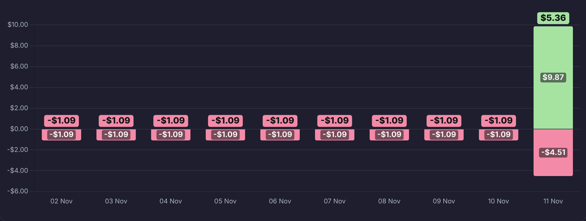
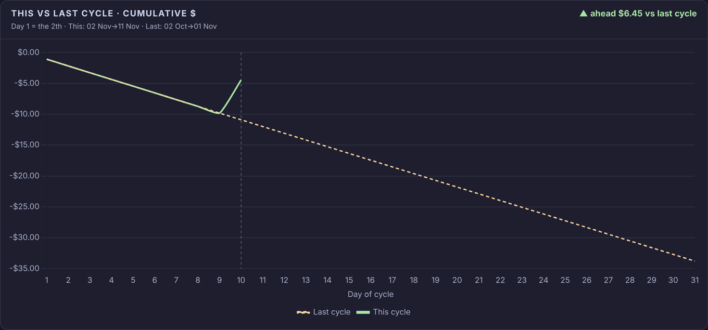
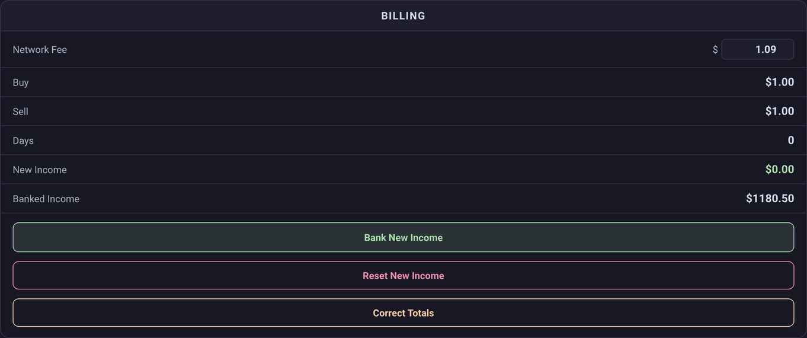
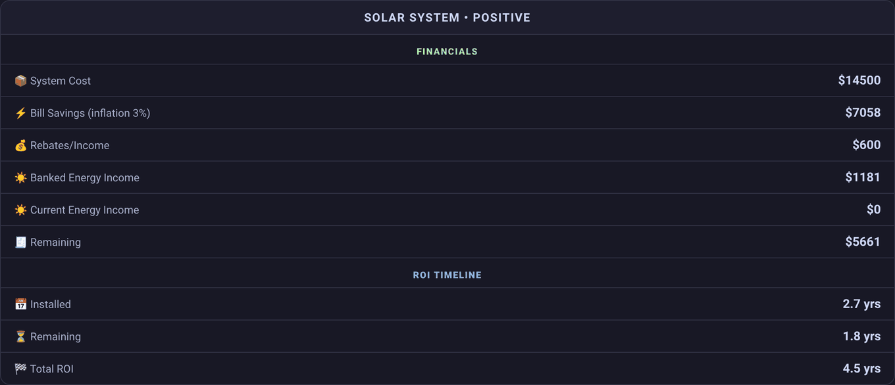
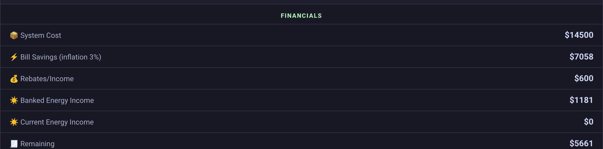
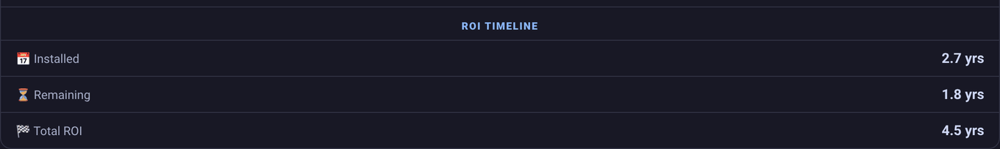

# Finances

The **Finances** view on the Battman dashboard is about money: what each day cost or earned, how this bill cycle compares with the last, your running totals, and how far the system is towards paying for itself. Its badges at the top show the battery level (**SOC**) and Amber's current buy (**Buy**) and feed-in (**FIT**) prices. Its cards sit one under the other, in the order below.

Amounts are in dollars. A net figure is sales less buying less the daily network charge (see [Billing](settings.md#billing) in Settings), green when it's $0 or more and red when it's below.

While **Show help** is on (see [Showing or hiding the guide](../README.md#showing-or-hiding-the-guide)), a **Help** button at the top right of the view puts a "?" on each card. The "?" opens that card's summary from this page.

| Card | What it is for |
|---|---|
| [Cost chart](#costchart) | Each day's cost and sales as bars, with today's figures, this and last bill, and the lifetime total. |
| [Cost compare](#costcompare) | This bill cycle's running net against the last cycle's, day by day. |
| [Billing](#billing) | The network fee, the running buy and sell totals, new and banked income, and the buttons that bank, reset or correct them. |
| [Solar System](#solar) | How far the system is towards paying for itself, and how many years are left. |

## Cost chart

<!-- guide:summary id="finances.costchart" -->
Each day's cost and sales as stacked bars, with the day's net above each one. Pick the days with the pills or the dates at the top. The strip under them shows today's selling and buying, this and last bill, and the lifetime total.
<!-- /guide:summary -->

The title says what's shown: "Last 10 Days Activity", "This Bill Cycle", "Last Bill Cycle", or the two dates of a range you picked. The figures come from Home Assistant's long-term statistics of Battman's buy, sell and network fee totals. If a sensor the card needs is missing, it says "Entity not found:" and which one.

### Ranges

<!-- guide:summary id="finances.costchart.ranges" -->
Pick the days the chart shows: the last 5, 10, 14, 20 or 30 days, this bill cycle or the last one. Or set **From** and **To** for any range up to today. The browser remembers your pick.
<!-- /guide:summary -->

| Pick | Shows |
|---|---|
| **5d** to **30d** | That many days, ending today. |
| **This cycle** | From the start of this bill cycle to today. |
| **Last cycle** | The whole bill cycle before this one. |
| **From** and **To** | The days from one date to the other. If **To** is before **From**, the two swap. |

A bill cycle starts on **Bill day of month** (see [Billing](settings.md#billing) in Settings). Until you pick, a card as narrow as a phone shows 5 days and a wider one 10.

### Totals

<!-- guide:summary id="finances.costchart.totals" -->
Today's energy sold and bought, with the average price of each. Then the net of this bill cycle and the last one, and the lifetime net: banked income plus everything since the totals were last reset.
<!-- /guide:summary -->

| Item | Shows |
|---|---|
| **Today Sell** | The kWh exported to the grid today, @ the average $ per kWh it sold for. |
| **Today Buy** | The kWh imported from the grid today, @ the average $ per kWh it cost. |
| **This Bill** | This billing period's net. |
| **Last Bill** | The last billing period's net. |
| **Lifetime** | **Banked Income** (on the [Billing](#billing) card) plus the sell total, less the buy and network fee totals, since the last **Reset New Income**. |

### Chart

<!-- guide:summary id="finances.costchart.chart" -->
One bar for each day: cost (network fee and buying) goes down from zero and sales go up. The badge above a bar is the day's net. Touch or hover over a bar to see its fee, buy, sell and net.
<!-- /guide:summary -->

| Colour | Means |
|---|---|
| Red | Below zero: the day's cost. |
| Amber | Above zero, under $2. |
| Green | $2 or more. |

Each segment shows its amount when it fits, and the net badge shows when there's room between bars. Today's bar uses today's running buy and sell totals and the current daily network charge. A day the totals were reset is worked out from hourly statistics, leaving out the reset, so it doesn't show as a loss. The chart redraws every minute.

## Cost compare

<!-- guide:summary id="finances.costcompare" -->
This bill cycle's running net against the last cycle's, from day 1 of each. The line at the top says how far ahead or behind you are today compared with the same day last cycle.
<!-- /guide:summary -->

| Item | Shows |
|---|---|
| "▲ ahead" or "▼ behind" | This cycle's net so far against last cycle's on the same day, "… vs last cycle". Green when ahead, red when behind. If last cycle had fewer days, it shows this cycle's net "so far". |
| The line under it | Which day of the month is day 1, and the dates of **This** and **Last** cycle. |
| **This cycle** | The solid line: the net added up day by day. |
| **Last cycle** | The dashed amber line. |
| Dashed upright line | Today's day of the cycle. |

The bottom axis is the "Day of cycle". Touch or hover to see both cycles' nets for that day, and how far ahead or behind. The card redraws every minute.

## Billing

<!-- guide:summary id="finances.billing" -->
The daily network fee, and the buy and sell totals since you last reset them, with the days they cover. **New Income** is what they come to; **Banked Income** is what you've put aside. The buttons bank, reset or correct the totals.
<!-- /guide:summary -->

| Row | Shows |
|---|---|
| **Network Fee** | The daily network charge, in $. Type a new one, from 0 to 5: "✓ Network fee saved". It's the same setting as **Daily network charge** under [Billing](settings.md#daily-network-charge) in Settings. |
| **Buy** | What you've paid for energy from the grid since the last **Reset New Income**. |
| **Sell** | What you've been paid for energy sent to the grid since then. |
| **Days** | The days since then. |
| **New Income** | **Sell** less **Buy** less **Days** times **Network Fee**. |
| **Banked Income** | What **Bank New Income** has put aside. |

### Buttons

<!-- guide:summary id="finances.billing.buttons" -->
**Bank New Income** adds New Income to Banked Income. **Reset New Income** sets Buy, Sell and Days back to 0. Neither asks first. **Correct Totals** opens a popup to fix a period's buy and sell totals, and asks before it changes anything.
<!-- /guide:summary -->

| Button | Does |
|---|---|
| **Bank New Income** | Sets **Banked Income** to **Banked Income** plus **New Income**: "✓ New income banked". It doesn't change **Buy**, **Sell** or **Days**. Banked Income can be from $0 to $50,000; a total outside that isn't saved. |
| **Reset New Income** | Sets **Buy**, **Sell**, **Days** and the network fee total back to 0: "✓ New income reset". Today's, this month's and this billing period's totals don't change. |
| **Correct Totals** | Opens the **Correct totals** popup (below). |

To put this period's income aside, press **Bank New Income**, then **Reset New Income**. Banking again before you reset adds the same income twice; resetting without banking leaves it out of **Banked Income** and **Lifetime**.

If either button can't save, it says "Not saved: Battman didn't take it". While the buy and sell totals have no value, the card says "Bank New Income: the buy and sell totals have no value yet, so there's nothing to bank." instead of showing the button.

#### Correct totals

"Fix a period's running totals. Battman asks first." There's a box for each period: **Today**, **Yesterday**, **This Month** and **Billing Period**. Each has **Sell $** and **Buy $**, filled in with the totals now, and two buttons:

| Button | Does |
|---|---|
| **Apply** | Asks first: "Set Today:" with each total's old and new amount, and "This overwrites the running totals." Then sets that period's sell and buy totals and says "✓ Today updated" (or the period's name). Both boxes need a number. |
| **Reset** | Puts the period's boxes back to the totals now. It changes nothing. |

If the totals don't take it, the box says "not changed. The totals ignored it". **Today** is what the [totals strip](#costchart-totals) works its Today prices from, and **Billing Period** is what **This Bill** comes from.

## Solar System

<!-- guide:summary id="finances.solar" -->
How the system is paying for itself: what it cost, what it has saved and earned, what's still to pay, and how many years that will take. The title gives a word for today's buying and selling. Its figures come from Settings → System & financials and the Billing card.
<!-- /guide:summary -->

The title is "Solar System •" and a word for today's sales less today's buying (the network fee isn't counted):

| Word | Today's sales less buying |
|---|---|
| **Profiting** | More than $10. |
| **Positive** | Above $0, up to $10. |
| **Neutral** | $0. |
| **Importing Power** | Below $0, down to -$10. |
| **Heavy Usage** | Less than -$10. |

The install details, rebates, pre-solar bills and bill inflation are set under [System & financials](settings.md#system) in Settings.

### Financials

<!-- guide:summary id="finances.solar.financials" -->
What the system cost, what it has saved on bills since it was installed, rebates, and the energy income banked and not yet banked. **Remaining** is what's left to pay off once all of those are taken away.
<!-- /guide:summary -->

| Row | Shows |
|---|---|
| **System Cost** | **Install cost** from Settings. |
| **Bill Savings (inflation …%)** | Your pre-solar bills for a year (the four [Pre-solar quarterly bills](settings.md#system-pre-solar-quarterly-bills) added up), counted day by day since **Install date** and grown each year by **Bill inflation**. |
| **Rebates/Income** | **Other income** from Settings. |
| **Banked Energy Income** | **Banked Income** on the [Billing](#billing) card. |
| **Current Energy Income** | **New Income** on the Billing card. |
| **Remaining** | **System Cost** less all the rows above it. |

Amounts are rounded to whole dollars.

### ROI Timeline

<!-- guide:summary id="finances.solar.roi" -->
How many years the system has been installed, how many more until it has paid for itself, and the two added together.
<!-- /guide:summary -->

| Row | Shows |
|---|---|
| **Installed** | The years since **Install date**. |
| **Remaining** | **Remaining** from Financials, divided by what the system earns a day: today's pre-solar daily bill (grown by **Bill inflation**) plus the energy income per day since the install date. |
| **Total ROI** | **Installed** plus **Remaining**. |

A figure the card can't work out shows "—".
