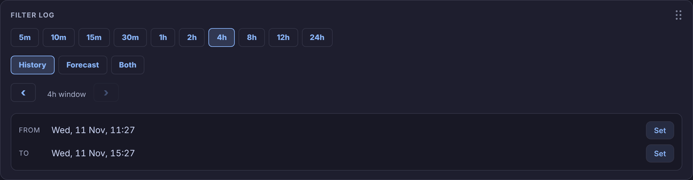
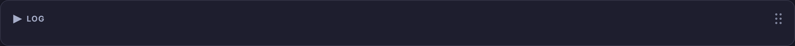
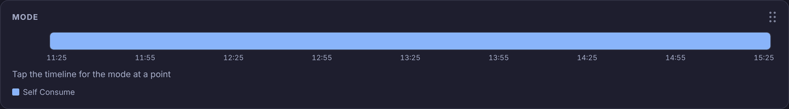
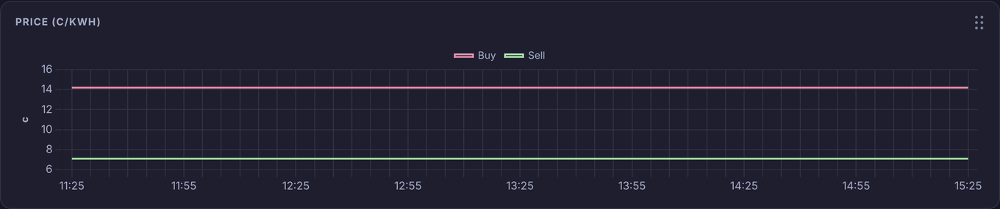
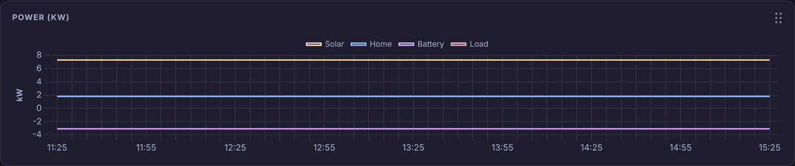
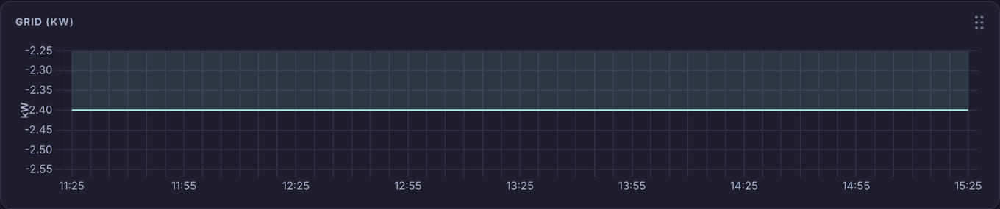
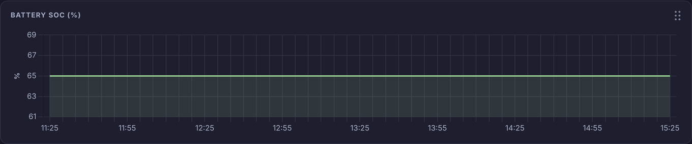
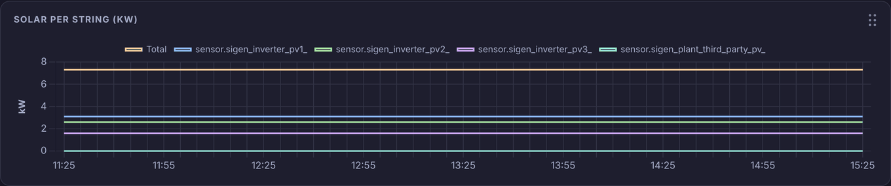

# Log

The **Log** view on the Battman dashboard shows what Battman's engine did, run by run, with its mode and the battery, price, power and grid figures charted over the same stretch of time. Pick the time in **Filter Log**; every other section follows it.

Pick **Forecast** or **Both** to see what the engine expects to do next, after a dashed "now" line, as well as what it has done.

The card reads Sigenergy and Amber sensors by name and Battman's own entities. If one it needs is missing, or the view's theme lacks a colour it uses, a **Battman Log problem** box says which instead of the sections.

While **Show help** is on (see [Showing or hiding the guide](../README.md#showing-or-hiding-the-guide)), a **Help** button at the top right of the view puts a "?" on each section. The "?" opens that section's summary from this page.

| Section | What it is for |
|---|---|
| [Filter Log](#controls) | The time window: quick ranges, **History** / **Forecast** / **Both**, paging, and **From** / **To**. |
| [Log](#log) | Each engine run in full, with mode and **Changes Only** filters. Folded to start. |
| [Mode](#mode) | A timeline of the battery mode. Tap it to read a moment and narrow the log to it. |
| [Price (c/kWh)](#price) | Amber's buy and sell prices. |
| [Power (kW)](#power) | Solar, home, battery and load power. |
| [Grid (kW)](#grid) | Power from the grid (up) and to it (down). |
| [Battery SOC (%)](#soc) | The battery's level. |
| [Solar per String (kW)](#solar) | Total solar and each string's share. |

## Moving sections

Drag a section by its grip, the six dots at its top right, to move it up or down the page. A dashed box shows where it will land. The order is kept in this browser, so another phone or computer keeps its own.

The **Log** section opens and closes when you tap its heading. It starts folded, and whether it's open isn't kept. Your choice of **History**, **Forecast** or **Both** is also kept in this browser.

## Filter Log

<!-- guide:summary id="log.controls" -->
Sets the time window for the whole view: a quick range from **5m** to **24h**, or your own **From** and **To**. **History** shows what happened, **Forecast** what the engine expects next, and **Both** the two either side of now. ‹ and › step the window back or forward by its own length.
<!-- /guide:summary -->

### Ranges and paging

| Control | What it does |
|---|---|
| **5m** … **24h** | In **History**, that long back from now. In **Forecast**, that long ahead of now. In **Both**, that long on each side of now, so **4h** shows 8 hours. The view opens on **4h**. |
| ‹ and › | Move the window back or forward by its own length, shown between them ("4h window"). |
| **From** / **To**, **Set** | **Set** opens a date and time picker. Times go to the nearest 5 minutes. |

A quick range moves on to now each time the engine logs a run. A window you set with **From**, **To**, or by paging back stays where it is. Picking a range also clears a tap on the [Mode](#mode) timeline.

Switching between **History**, **Forecast** and **Both** puts the window back to **4h**.

### History, Forecast and Both

| Button | Window |
|---|---|
| **History** | Any time up to now. › stops at now. |
| **Forecast** | From now to the end of the forecast. |
| **Both** | Any **From**; **To** goes no further than the end of the forecast. |

The forecast is what Battman's engine would do over the next 24 hours, from the same forecast as **Next hours** on the Power view's [State](power.md#state) card. Battman fetches it once, when the view opens on **Forecast** or **Both** or you first pick one. The round-arrow button at the end of that row (**Reload forecast**) fetches a fresh one. If it fails, the section says "Forecast failed:" and why.

## Log

<!-- guide:summary id="log.log" -->
Each engine run in full, as in the **Engine log** on the Power view, with the run's mode colour down its left edge. Tap **Log** to open or close it. Tick or untick modes, or tick **Changes Only**, to cut the list down.
<!-- /guide:summary -->

### Filters

- **Modes:** one checkbox for each mode, in that mode's colour. Untick a mode to hide the runs that ended in it.
- **Changes Only:** shows only the runs where the mode changed.
- A tap on the [Mode](#mode) timeline narrows the list to the 5 minutes around that point. The count line then ends with "block" and the times, for example "block 14:05–14:10 (Charge)". Pick a range in **Filter Log** to clear it.

The count line above the entries says how many are shown, for example "12 of 48 entries".

### Reading an entry

Each entry starts with **Engine run** and the run's time. Under it, each heading from the run (**Mode**, **Prices**, **Battery** and so on) sits in its own coloured block. **Mode** shows the mode before and after the run ("Self Consume → Charge"). **True** is green, dollar amounts are green, or dark red when below zero.

In **History** the newest run is at the top. In **Forecast** and **Both** the list runs forward in time. Each time the engine logs a run, the list reloads.

### Forecast entries

In **Forecast** and **Both**, the expected stretches follow the past runs, each with a dotted bar in its colour. They read the same as **Next hours**:

| First line | Colour | When |
|---|---|---|
| "Sell … kWh" | green | Discharge |
| "Buy … kWh" | yellow | Charge |
| **Hoooover**, "Buy … kWh" | purple | Charge Solar Off |
| **House Party**, "Run the house off the grid" | purple | Float Solar Off |
| "Drain … kWh" | red | Drain |
| "Hold the battery at …%" | green | Float |
| "Do nothing" | orange if it costs money, green if solar fills the battery, otherwise blue | any other mode |

Each one gives its times ("Now" for the current one), the battery level, what it earns (green, "+$") or costs (yellow, "−$"), why, and the house and solar power. The mode checkboxes and **Changes Only** work on these too.

## Mode

<!-- guide:summary id="log.mode" -->
A bar coloured by the battery's mode across the window, lined up with the charts below. Tap or drag along it to read the time, mode, how long that mode ran, and the buy price, sell price and SOC at that point. A tap also narrows the log to those 5 minutes.
<!-- /guide:summary -->

### Tapping and dragging

- **Tap** a point: a red marker shows on the bar and a red line in every chart, the line under the bar reads that moment, and the [Log](#log) shows only the runs within 2½ minutes of the nearest one. Tapping a point after now reads it but leaves the log as it is.
- **Drag** along the bar: the marker and the lines follow your finger without changing the log.
- Tap or drag across a chart to move the same red line; that never changes the log.

The reading gives the time, the mode, and its length: "12 min", "30 min+" when it began before the window, or "5 min so far" while it's still running. The buy and sell prices and SOC come from the nearest engine run. After now they come from the forecast, marked **FORECAST**.

### Colours

Each mode has the colour of its button on the Power view's [Battery mode](power.md#batterymode) card. The legend under the bar lists the modes in the window. In **Forecast** and **Both**, a dashed line marks now and the blocks after it are paler, with stripes.

## Price (c/kWh)

<!-- guide:summary id="log.price" -->
Amber's buy price (**Buy**, red) and feed-in price (**Sell**, green) across the window, in c/kWh. Hover or tap the chart to read both at a point.
<!-- /guide:summary -->

### Reading the charts

This holds for every chart on the view:

- Lines step from one reading to the next. A chart with one line is filled under it.
- Hovering or tapping shows each line's value at that time, with its unit.
- On a chart with several lines, tap a name in the legend at the top to hide or show that line.
- In **Forecast** and **Both**, a dashed line marks now. After it the chart is shaded and the lines are dashed.
- The charts redraw every minute. "No data in range" means none of the chart's sensors has a reading in the window.

## Power (kW)

<!-- guide:summary id="log.power" -->
The plant's solar power, the home's power, the battery's power and Battman's 30-minute average load, in kW. Use it to see where power went at any point in the window.
<!-- /guide:summary -->

### The lines

| Line | Colour | Sensor |
|---|---|---|
| **Solar** | amber | `sensor.sigen_plant_pv_power` |
| **Home** | blue | `sensor.sigen_plant_consumed_power` |
| **Battery** | purple | `sensor.sigen_plant_battery_power` |
| **Load** | red | `sensor.battman_load_30m_avg` |

After now, **Home** and **Load** both show the forecast's house load.

## Grid (kW)

<!-- guide:summary id="log.grid" -->
Grid power in kW: above zero is importing, below zero is exporting. It's worked out from the Sigenergy import and export sensors.
<!-- /guide:summary -->

### How it's worked out

Whichever of `sensor.sigen_plant_grid_import_power` and `sensor.sigen_plant_grid_export_power` is over 50 W gives the figure: import as plus, export as minus. When neither is, it shows 0. There's a point only where both sensors have a reading.

## Battery SOC (%)

<!-- guide:summary id="log.soc" -->
The battery's state of charge in %, from `sensor.sigen_plant_battery_state_of_charge`. After now it follows the forecast's battery level.
<!-- /guide:summary -->

## Solar per String (kW)

<!-- guide:summary id="log.solar" -->
The plant's total solar power and each solar string's power, in kW. Only strings that report a reading are drawn, and a third-party inverter is added when there is one.
<!-- /guide:summary -->

### The lines

| Line | Sensor |
|---|---|
| **Total** (amber) | `sensor.sigen_plant_pv_power` |
| One per string | `sensor.sigen_inverter_pv1_power` to `sensor.sigen_inverter_pv12_power`, those that aren't unavailable or unknown |
| **3rd Party** | `sensor.sigen_plant_third_party_pv_power`, when it isn't unavailable or unknown |

A string is named "String 1", "String 2" and so on, or by its own name once you rename the sensor in Home Assistant (for example "North Solar"). After now, only **Total** has a forecast.
