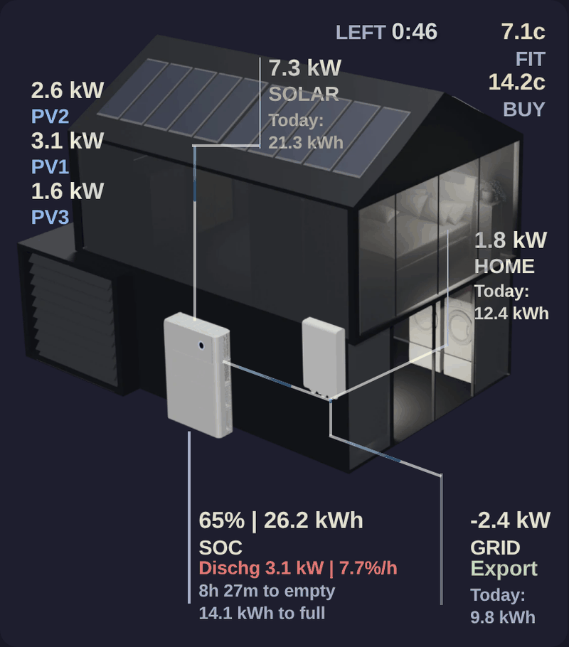
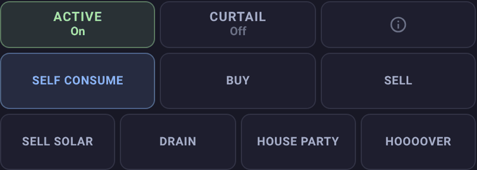
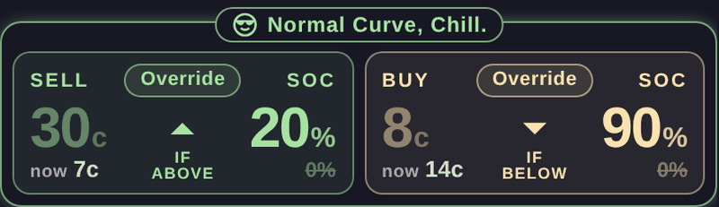
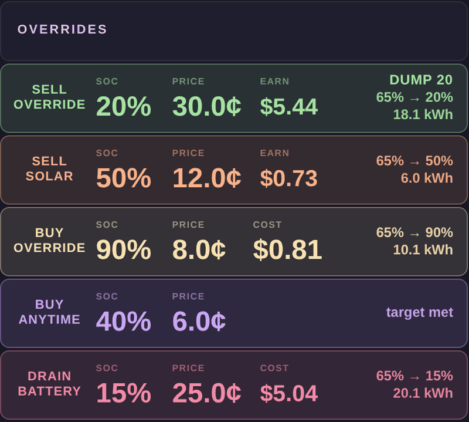
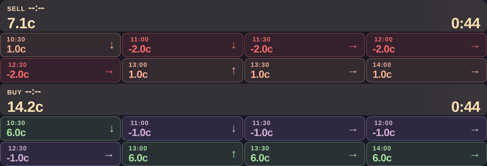
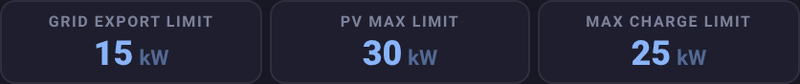
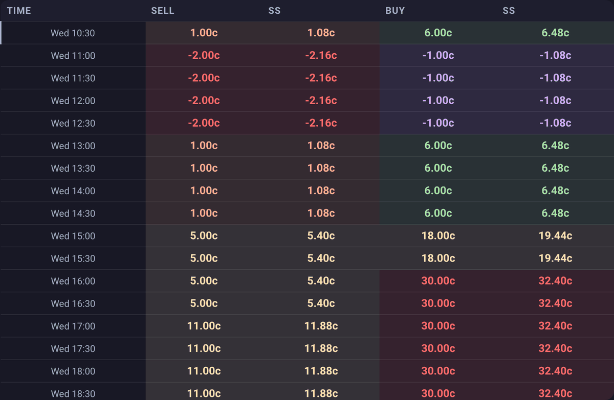
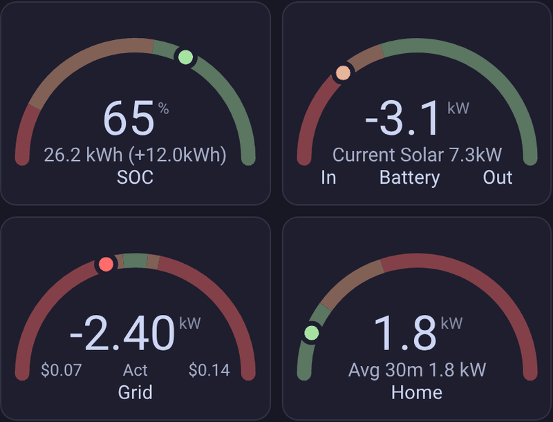
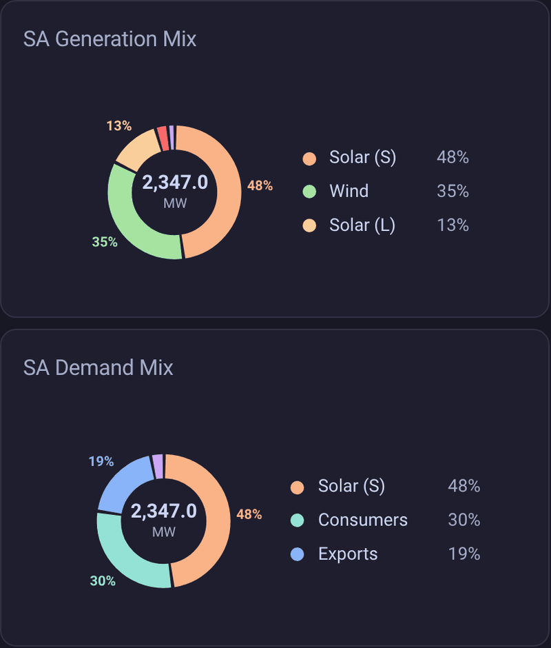

# Power

The **Power** view on the Battman dashboard is the live picture: what the house, battery and grid are doing now, what Battman is about to do, and the prices coming up. Its cards sit in three columns, in the order below.

Most of these cards read Sigenergy and Amber sensors by name (`sensor.sigen_plant_…`, `sensor.amber_5min_…`). A card whose sensor is missing says which one instead of showing made-up numbers. Prices are in c/kWh (cents per kWh) unless a card shows dollars.

While **Show help** is on (see [Showing or hiding the guide](../README.md#showing-or-hiding-the-guide)), a **Help** button at the top right of the view puts a "?" on each card. The "?" opens that card's summary from this page.

| Card | What it is for |
|---|---|
| [House](#house) | The house picture with live prices, solar, home, grid and battery numbers on it. |
| [Battery mode](#batterymode) | **Active** and **Curtail**, the engine log, and the buttons that set the mode by hand. |
| [State](#state) | What the engine would do right now, and why. Tap for the next hours. |
| [Profit / Loss](#profitloss) | Today's selling, buying, gross and net, in dollars. |
| [Overrides](#overrides) | The five overrides, their timer, presets, scenes and the Net Target. |
| [Amber 5-minute price grid](#amber5minpricegrid) | Current sell and buy price, the countdown to the next price, then the next eight. |
| [Limits](#limits) | Grid export, PV max and max charge limits. |
| [Amber 24-hour forecast table](#amber24hourforecasttable) | Every interval of Amber's forecast, with Amber Advanced's prediction. |
| [Gauges](#gauges) | Battery level, battery power, grid power and home power. |
| [NEM mix](#nemmix) | Where your region's electricity comes from and where it goes. |

## House

<!-- guide:summary id="power.house" -->
The house picture with live numbers laid over it: Amber's buy and feed-in prices, solar, home, grid and battery power, and lines that move while power flows. Tap a number to open its sensor. The card draws itself, so it needs no other custom card.
<!-- /guide:summary -->

### What you read

| Item | Shows |
|---|---|
| **FIT** and **BUY** | Amber's feed-in and buy prices in c, coloured by price band (see the [price grid](#amber5minpricegrid)). **LEFT** counts down to the next 5-minute price. |
| **SOLAR** | The plant's solar power in kW, with **Today:** kWh under it. **PV1**, **PV2** and **PV3** show each string's share of that power, not the string sensor's own reading. |
| **HOME** | Home power in kW, with **Today:** kWh under it. |
| **SOC** | Battery level in %, then kWh. Under it, in green "Chg 2.4 kW" with the rate in %/h, in dark red "Dischg", or "Floating". Then the time "to full" or "to empty" and the kWh "to full" ("Full" at 100%). |
| **GRID** | Grid power in kW: positive is importing, negative is exporting. Anything under 50 W shows 0. Under it, **Import** (dark red) or **Export** (green) with today's kWh. |
| Outside temperature, battery temperature, **Device 1** to **Device 3** | Drawn only once you pick a sensor for them. |

The lines move while solar is producing, the house is drawing power, the battery is charging or discharging, and the grid is importing or exporting. The direction of the movement is the direction of the flow.

Tap a number to open its sensor's details. Tapping **GRID** opens the Energy dashboard. The countdown and the **Import** / **Export** line do nothing.

### Using your own sensors

In the dashboard editor, every item has its own fold-out: **Show**, **Entity**, **Text**, and where they apply **After the value (e.g. W)** and **Picture (e.g. /local/house.png)**. **Solar power** and **Solar today** also take a second sensor ("Add this sensor too (e.g. a third-party inverter; same unit)") that is added to the first.

An item whose sensor doesn't exist isn't drawn, and nothing says so. If a number is missing, check its sensor in the editor.

## Battery mode

<!-- guide:summary id="power.batterymode" -->
**Active** turns Battman's control of the battery on or off, **Curtail** stops exports, and the info button opens the engine log. The mode buttons below set the battery's mode by hand; the one for the current mode is lit. A button asks first when pressing it goes against the price.
<!-- /guide:summary -->

### Active, Curtail and the engine log

- **Active:** tap asks "Turn Active?". Turning it off says "Battman will stop controlling the battery."; turning it on says "Battman will control the battery again."
- **Curtail:** tap asks "Turn Curtail?". Turning it on says "This will stop any exports." Turning it off says "Exports resume. Curtail stops them while feed-in is negative.", or, while feed-in is negative, "Feed-in is -x.xc. Turning off means you pay to export."
- **Information button:** opens the **Engine log**, the engine's account of its last run.

Each question has **Cancel** and a **Turn on** or **Turn off** button. Holding **Active** or **Curtail** opens that switch's details.

Curtail on sets the Sigenergy grid export limit to 0, and puts it back to 0 if something raises it while Curtail is on. See [Limits](#limits).

### The mode buttons

| Button | Mode it sets | Lit in | Asks first when |
|---|---|---|---|
| **Self Consume** | Self Consume | blue | never |
| **Buy** | Charge | yellow | the buy price is above the limit in **Warn on Buy above** |
| **Sell** | Discharge | green | feed-in is negative |
| **Sell Solar** | Float | orange | feed-in is negative |
| **Drain** | Drain | red | never |
| **House Party** | Float Solar Off | yellow | the buy price is 0 or more |
| **HOOOOVER** | Charge Solar Off | green | the buy price is 0 or more |

The question is the button's name with the reason, and an "… anyway" button next to **Cancel**. The wording and the two settings behind it are under [Confirmations](settings.md#dashboard-confirmations). **House Party** and **HOOOOVER** are for negative buy prices.

With **Simple battery mode** on ([Dashboard options](settings.md#simple-battery-mode)), the card shows only **Buy**, **Sell** and **Self Consume**, and only while the mode is Charge, Discharge or Self Consume. In any other mode it shows the full set.

A mode set by hand shows on the [State](#state) card as "Manual mode change · " and the button's name.

## State

<!-- guide:summary id="power.state" -->
What the engine would do right now. The **SELL** and **BUY** tiles show the price and battery level each side needs, and glow while that side is acting. The pill at the top says which curve is in use; the pill at the bottom says what the engine is doing and why. Tap the card for the next hours.
<!-- /guide:summary -->

### The tiles

Each tile shows a price on the left, an arrow, and a battery level (SOC) on the right, with "if above" (SELL) or "if below" (BUY) between them. SELL acts when the feed-in price is at or above its price and the battery is above its level. BUY acts when the buy price is at or below its price and the battery is below its level.

- **Glowing:** that side is acting.
- **Dimmed numbers:** that condition isn't met. The live value shows under it as "now".
- **Top of the tile:** **Low** (SELL) or **High** (BUY) price from [Sell](settings.md#sell) and [Buy](settings.md#buy), or a badge saying why the numbers are what they are:

| Badge | Means |
|---|---|
| **Override** | A Sell Override or Buy Override sets the price or level. |
| **Solar** / **Anytime** | Sell Solar or Buy Anytime is driving, and the tile shows its numbers. |
| **Rule** | A sell rule set the price (SELL only). |
| **Prorated** | The sell price is the prorated one (SELL only). |
| **Protected** | Sell price protection is on (SELL only; see [Sell price protection](settings.md#protection)). |
| **Peak 5–9pm** | The evening peak (BUY only). |
| **Hooover** / **House Party** | The mode is HOOOOVER or House Party. The tile shows the live buy price and "Filling up" or "Paid to use". |
| **Plughole** | Drain is running at a negative buy price. The tile is red and says "Skipping negative buy", or "Waiting for" the Buy Override's negative price. |

### The pills

The top pill is one of "Normal Curve, Chill." (green), "Needy Curve, No Sun, Panic!" (orange) or "Needy Curve, High Consumption, Panic!" (dark red). See [Needy curve triggers](settings.md#needy). While the [Auto curve switcher](settings.md#auto-curve) is on, an **Auto** pill sits at the top right, with an orange warning icon when it couldn't act.

The bottom pill names the side that is acting ("Selling" or "Buying") and its reason: an override with its price and level (for example "Sell Override 25c >40%"), "Rule" with "best to" (SELL) or "cheapest to" (BUY) and the time it looks ahead to, "Spike", and so on. When the conditions are met but the mode isn't, it says "Would sell" or "Would buy". For an override that is allowed to reset, it ends with a clock icon and the time it will clear.

### While off-grid

When the Sigenergy grid status is "Off Grid (Auto)" or "Off Grid (Manual)", the card is replaced by a pulsing red (auto) or orange (manual) **OFF GRID!!** panel. It shows how long you've been off ("Panic · Off Grid · off for 1h 05m"), **Lasts about** and **Halve load** (hours the battery lasts at the current load, and at half of it), **Battery** and **Load**. The pill under it reads "On battery" with the solar power, or "No solar". **Lasts about** and **Battery** turn red when the battery will last under 2 hours or is under 15%.

### The next hours

Tap the card to open **Next hours**: what Battman's engine would do over the coming hours, slot by slot. Under **What-if** you can change **Battery level**, **Solar**, **House load**, **Buy price shift** and **Sell price shift** to see the effect. Those changes stay in the window and are never sent to the battery; **Reset to live** puts them back.

## Profit / Loss

<!-- guide:summary id="power.profitloss" -->
Today's selling and buying in dollars, the gross between them, and the net after your daily network charge. Green when you're ahead, dark red when you're behind. A value Battman doesn't have shows as a dash, never $0.00.
<!-- /guide:summary -->

### What the figures are

| Figure | Is |
|---|---|
| **SELL** | Today's sell total, in green. |
| **BUY** | Today's buy total, in dark red. |
| **GROSS** | **SELL** minus **BUY**. |
| **NET** | **GROSS** minus the [Daily network charge](settings.md#billing). |

**GROSS** and **NET** are green at zero or above and dark red below. The card's border takes the colour of **NET**. Tapping does nothing.

If `sensor.battman_sell_total`, `sensor.battman_buy_total` or `sensor.battman_parameters` is missing, the card says "Profit / Loss: missing" and names it.

## Overrides

<!-- guide:summary id="power.overrides" -->
Five overrides (Sell Override, Sell Solar, Buy Override, Buy Anytime and Drain Battery), each with a battery level (SOC) and a price. A strip shows what's set, a row appears for each override that is set or pinned, and a timer says how long they last. Tap the strip for the control centre, a row to edit it, the timer to change it.
<!-- /guide:summary -->

| Override | SOC is | Price is |
|---|---|---|
| **Sell Override** (green) | The level to sell down to, in place of the curve. 100% means no selling. | The lowest sell price it will sell at. |
| **Sell Solar** (orange) | The level above which solar is sold, in place of the curve. | The lowest sell price it will sell solar at. |
| **Buy Override** (yellow) | The level to buy up to, in place of the curve. | The highest buy price it will pay. Can be negative. |
| **Buy Anytime** (purple) | The level to charge up to at any time, ignoring the curve. | The highest buy price it will pay. |
| **Drain Battery** (red) | The level to drain down to with solar off, then the override clears. 100% means no draining. | Drain only while the price is below this. |

An override with only a SOC still follows the curve's prices, and one with only a price still follows the curve's SOC. With both, both must be met and the curves are ignored. Spike selling beats every override ([Spike selling](settings.md#spike)).

### The strip and the rows

The strip reads **OVERRIDES**, or **OVERRIDES · NO SELL** while a Sell Override or Drain Battery has SOC 100. Tap it for the control centre; hold it for how the dock works. On the right it can show:

- **No reset**, with a dot per locked override, when a set override has **No Reset** on. The strip's border turns amber.
- A blue chip with a moon, a scene's name and 00:01, when a scene is armed.
- **Plughole**, when Drain Battery has it on (**Drain instead of House Party**).
- The Net Target readout, in teal (see below).

Each row shows the override's name, **SOC**, **PRICE**, and a dollar figure (**EARN** or **COST**) that estimates the kWh still to move times the price. The right-hand text is the preset's name, "TAP TO SET" for a pinned override that is off, "NO SELLING" or "NO DRAINING", "PLUGHOLE", the move "42% → 80%" with its kWh, or "target met". A padlock means **No Reset** is on.

- **Tap a row:** quick edit. **SOC %**, **PRICE ¢**, **No Reset**, a timer (**Start for** 15m, 30m, 1h or 2h; **Run until** sunrise, sunset, midnight or 06:00; or **Timer h** or **Until**, where filling one clears the other), then **Clear**, **Save** (as a preset) or **Set**. Presets for that override sit above as chips. Buy Anytime also has a cost preview and **Calculate cheapest price**, which fills **PRICE ¢** from Amber's forecast with the lowest limit that still reaches the SOC by the finish time.
- **Double-tap a row:** clears it straight away.
- **Hold a row:** what its values mean.

An override that isn't locked clears itself when its timer finishes or is cancelled, when its SOC target is met while no timer is running, and at the daily reset ([Reset overrides at](settings.md#watchdog)). **No Reset** stops that. A Sell Override at 100% is never cleared by the watchdog.

> [!NOTE]
> **Known problem.** The strip says **OVERRIDES · NO SELL** for a Drain Battery set to 100% as well, although that stops draining, not selling.

### The timer

The timer bar shows while the timer is running and an override is set or pinned, or all the time with **Always show override timer** on ([Dashboard options](settings.md#always-show-override-timer)).

- **Switch:** starts the timer for its set length (12 hours to begin with), or cancels it.
- **Middle:** the countdown and "until" time, or **OFF** and "tap to set". Tap for the timer sheet: **Extend** (+15m, +30m, +1h, +2h) or **Start for**, **Run until**, **Set until** or **Duration h**, **Cancel timer** and **Set**. Hold for the timer's details.
- **H / M, − and +:** **H** or **M** picks the step. **+** adds an hour or a minute, or starts the timer. **−** takes it off a running timer and does nothing while the timer is off.

While the timer runs, overrides don't clear when they reach their SOC. When it finishes or is cancelled, unlocked overrides clear.

### Presets and scenes

A **preset** is one override's SOC, price, **No Reset** and timer under a name. A **scene** is two or more overrides, or an override and a Net Target, saved together. In the control centre, **＋ Save current** saves what's set now: one override becomes a preset chip, more become a scene. Pressing a chip applies it; pressing a scene replaces every override and the Net Target.

A scene that includes a Net Target has a moon: press it to arm that scene, and it's applied at 00:01. A timer saved with **Until** works out the time again each time it's applied. **Manage** shows a **×** on each chip to delete it. The pin on each override in the control centre keeps its row on the card while it's off.

### Net Target

The Net Target is a goal for today's net (sell total minus buy total minus the [Daily network charge](settings.md#billing)). Set it in the control centre: **Sell** for a target, **Buy** for a budget, **Break even**, or **−** and **+** in 5¢ steps (hold to go faster). **Set** on one side clears the other.

The strip counts down "to make" or "to spend" beside **SELL TARGET** or **BUY BUDGET**, or **BREAK EVEN**. When it's reached the strip shows **TARGET MET** or **BUDGET REACHED** with the time and **NET TODAY**, and the watchdog clears that side's overrides: Sell Override, Sell Solar and Drain Battery for a sell target, Buy Override and Buy Anytime for a buy budget. The readout stays until the timer ends, a new target is set, or midnight. With no buy or sell totals, the control centre says "Buy / sell totals unavailable, so no target can be set".

## Amber 5-minute price grid

<!-- guide:summary id="power.amber5minpricegrid" -->
Amber's current SELL price above its current BUY price, each with a countdown to the next 5-minute price and the next eight periods after it. Prices are in c/kWh and coloured by band; an arrow on each period says whether it's up or down on the one before.
<!-- /guide:summary -->

### Reading it

The wide tile at the top of each half shows **SELL** or **BUY**, the time the price started, the price, and on the right the countdown to the next price. While Battman's estimated-price sensor is on, the price pulses and the countdown has **Estimating** above it. Under it are the next eight periods, each with its start time, its price and ↑, ↓ or → against the period before it (the first against the current price).

A price Battman doesn't have shows "—" on a grey tile.

| Colour | Buy price | Sell price |
|---|---|---|
| Purple | below 0c | 25c and above |
| Green | 0c to 8c | 15c to below 25c |
| Yellow | above 8c to 25c | 5c to below 15c |
| Orange | | 0c to below 5c |
| Dark red | above 25c | below 0c |

The [House](#house) card colours its prices the same way. The prices come from `sensor.amber_5min_current_general_price` and `sensor.amber_5min_current_feed_in_price`, and the periods from the two `sensor.amber_billing_interval_forecasts_…` sensors. If a forecast is empty the card says "No SELL forecast from" or "No BUY forecast from" and the sensor.

> [!NOTE]
> **Known problem.** The times on this card follow this device's time zone. The [forecast table](#amber24hourforecasttable) uses Home Assistant's. They match only when both are in the same zone.

## Limits

<!-- guide:summary id="power.limits" -->
Three Sigenergy limits in blue: **Grid Export Limit**, **PV Max Limit** and **Max Charge Limit**. Tap one to open its control and change it. Battman's own automations also set them, so a value you set can be replaced at the next mode change.
<!-- /guide:summary -->

### What it shows

Each tile shows the limit as a whole number with its unit, or "—" when the sensor has no value. A limit with decimals is rounded for display only. The tiles read `number.sigen_plant_grid_export_limitation`, `number.sigen_plant_pv_max_power_limit` and `number.sigen_plant_ess_max_charging_limit`.

### What changes them

- **Curtail** (the [Battery mode](#batterymode) card) sets **Grid Export Limit** to 0, and puts it back to 0 if you raise it while Curtail is on. Turning Curtail off sets it to 18.2 kW.
- **A mode change** sets **Max Charge Limit** and **PV Max Limit**. **Sell Solar** and **House Party** cut **Max Charge Limit** to 0.1 kW and put **PV Max Limit** at 20 kW. **Drain** puts **PV Max Limit** at 0. Every other mode puts **Max Charge Limit** back to the plant's rated charging power and **PV Max Limit** at 20 kW.

> [!NOTE]
> **Known problem.** Curtail off always sets **Grid Export Limit** to 18.2 kW, a fixed value, not the limit you had before.

## Amber 24-hour forecast table

<!-- guide:summary id="power.amber24hourforecasttable" -->
Every interval of Amber's forecast in one scrolling table: its start time, the Sell price, Amber Advanced's predicted Sell (SS), the Buy price and Amber Advanced's predicted Buy (SS). Each price is coloured by band, and the first row, the current interval, has a blue marker.
<!-- /guide:summary -->

### Reading it

The **Time** column is the start of each interval in Home Assistant's time zone, as "Tue 14:30". Prices are in c with two decimals. **Sell** is shown as what you earn: positive earns, negative means you pay to export. **Buy** is the buy price. **SS** is Amber Advanced's predicted price for that interval, and "—" where Amber gives none.

The colours use the same bands as the [price grid](#amber5minpricegrid), judged on the price shown. A Sell of exactly 0c is dark red here but orange on the grid and the [House](#house) card. The header stays put while the rows scroll.

The table has a row for each interval in `sensor.amber_billing_interval_forecasts_feed_in_price`, with the buy price matched from `sensor.amber_billing_interval_forecasts_general_price` by interval. Without forecasts it says "Missing Amber forecast data" and names both sensors. If Home Assistant has no time zone set, it says so and points to **Settings → System → General**.

## Gauges

<!-- guide:summary id="power.gauges" -->
Four half gauges: battery level (SOC), battery power, grid power and home power, each with a line under it. The colours show whether a reading is comfortable (green), worth a look (orange) or extreme (dark red).
<!-- /guide:summary -->

### Each gauge

| Gauge | Scale | Colours | Line under it |
|---|---|---|---|
| **SOC** | 0 to 100% | dark red below 15%, orange 15% to 55%, green above | The battery's kWh, then in brackets Solcast's cautious (10%) estimate of the solar still to come today, as "(+x kWh)". |
| **In Battery Out** | −10 to 15 kW | dark red below −4, orange −4 to 0, green above 0 | **Current Solar** in kW. |
| **Grid** | −15 to 15 kW | green within 1 kW of zero, orange 1 to 2 kW out, dark red beyond 2 kW | The feed-in price, **Est** or **Act**, then the buy price, in dollars. |
| **Home** | 0 to 15 kW | green below 3 kW, orange 3 to 6, dark red above 6 | **Avg 30m** in kW, with a lightning bolt while the engine is on the needy curve for high consumption. |

**Grid** reads Battman's grid power: positive is importing and negative is exporting, and anything under 50 W is 0. **Est** shows while the current price is an estimate and **Act** once Amber's actual price is in. The average on **Home** is the 30-minute average that [House power above](settings.md#needy) uses.

A value Battman doesn't have shows as "—". The gauges are drawn by the `modern-circular-gauge` card, a separate card that Battman needs installed.

> [!NOTE]
> **Known problem.** The battery gauge is labelled "In Battery Out" from left to right, with dark red on the left and green on the right. The [House](#house) card reads the same sensor the other way: a positive reading is "Chg" (charging) and a negative one is "Dischg". The two disagree about which way the battery is moving. Compare both with what the battery is actually doing.

## NEM mix

<!-- guide:summary id="power.nemmix" -->
Two pie charts of your region's electricity from the National Electricity Market: where it's generated and where it goes, in MW. The figures come from the OpenNEM integration, which Battman finds by itself. Without it the card is empty and says so.
<!-- /guide:summary -->

### Reading it

**SA Generation Mix** has **Wind**, **Solar (S)** (rooftop), **Solar (L)** (utility), **Imports**, **Battery**, **Gas** (all four gas types together) and **Distillate**. **SA Demand Mix** has **Consumers**, **Solar (S)**, **Exports** and **Battery Charging**. Slices are sorted largest first, and a slice under 4% has no label.

> [!NOTE]
> **Known problem.** The pie titles always say "SA", whichever region OpenNEM gives Battman.

### When it's empty

- **OpenNEM isn't installed:** "NEM mix needs the OpenNEM integration: install it from HACS and add it for your region (Settings → Repairs has the steps)." See [Battman's NEM mix card needs OpenNEM](../help/repairs.md#opennem-missing).
- **Several regions:** Battman can't tell which to read until you pick one. See [Pick your OpenNEM region](../help/repairs.md#opennem-choose).
- **A figure is missing:** a line above the pies reads "NEM mix: no value from" and names the sensors, with the reason when there is one.
