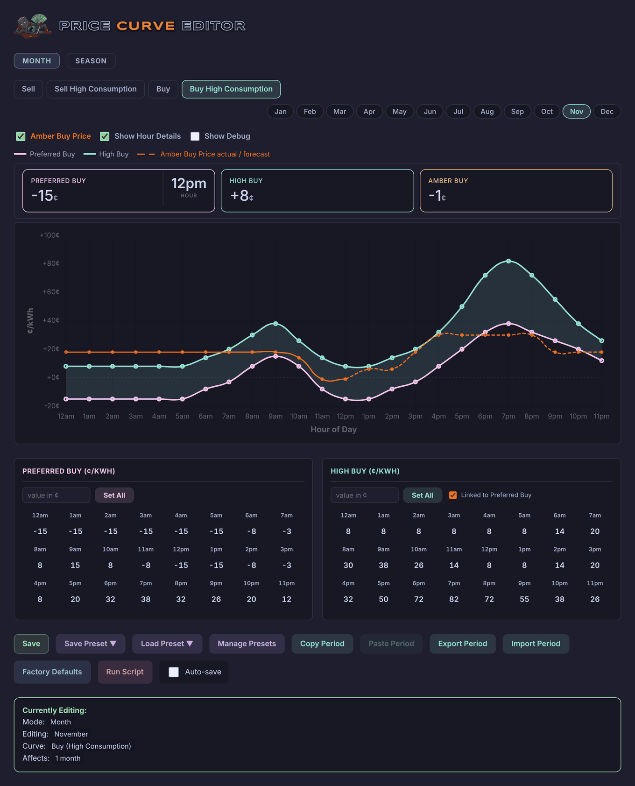
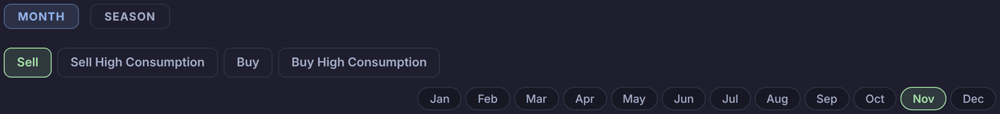
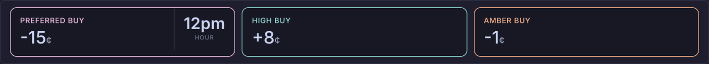
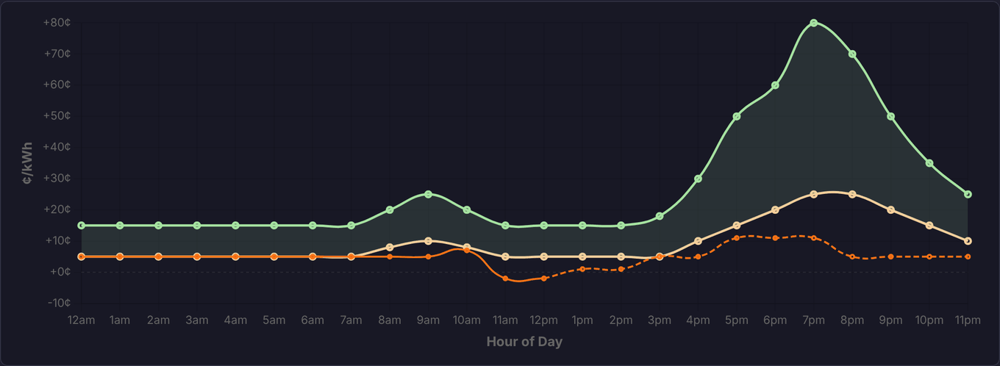
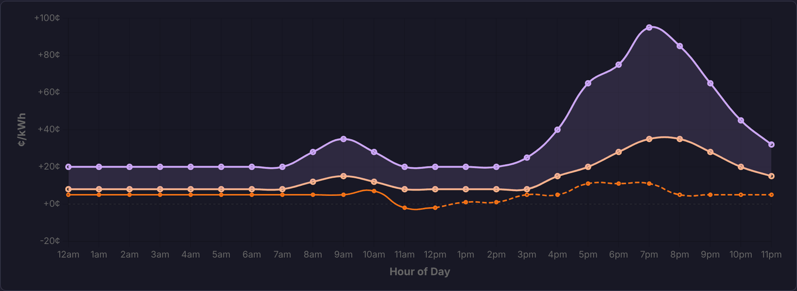
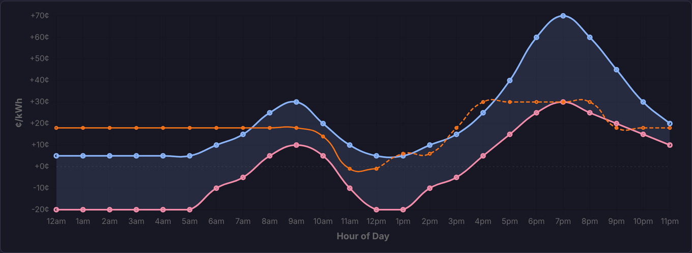
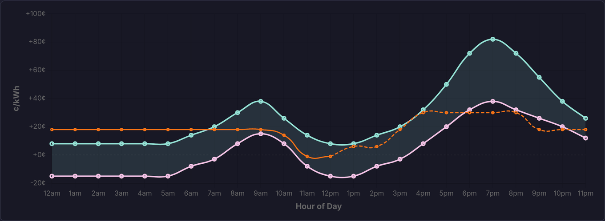
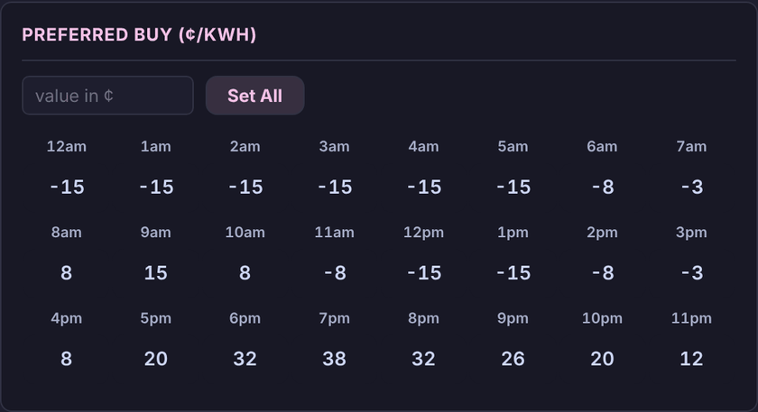
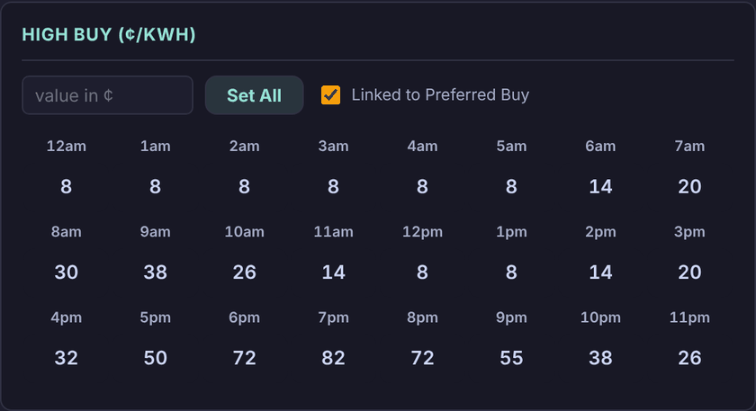
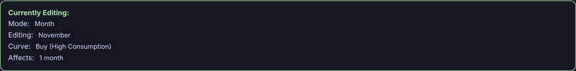

# Pricy

The **Pricy** view is the price curve editor. For each hour of each month it holds the prices Battman's engine works to, in ¢/kWh: for selling, a preferred price and a low one; for buying, a preferred price and a high one. Each comes in a normal version and one for times of high consumption. The battery levels that go with them are set on [Curvy](curvy.md).

While **Show help** is on (see [Showing or hiding the guide](../README.md#showing-or-hiding-the-guide)), a **Help** button at the top right of the view puts a "?" on each part of the editor. The "?" opens that part's summary from this page.

| Part | What it is for |
|---|---|
| [Period and curve](#edit) | **Month** or **Season**, and which curve and period you're editing. |
| [Chart options](#options) | The Amber price line, the hour details, and the debug log. |
| [Hour details](#readouts) | The two prices and Amber's price at one hour. |
| [Chart](#chart) | The two prices you're editing, with today's Amber prices over them. |
| [Preferred Sell or Preferred Buy](#preferred) | The preferred price for each hour, and **Set All**. |
| [Low Sell or High Buy](#second) | The second price for each hour, **Set All**, and whether it follows the preferred price. |
| [Buttons](#buttons) | Save, presets, copy and paste, files, factory curves, Run Script and Auto-save. |
| [Currently Editing](#editing) | What you're editing and which months a change affects. |

## Period and curve

<!-- guide:summary id="pricy.edit" -->
Pick **Month** or **Season**, then one of the four curves and the month or season to edit. The editor opens on this month, on **Sell** from 5 pm until 10 pm and on **Buy** otherwise (the High Consumption one while the house is using more than the **Battman high consumption** helper).
<!-- /guide:summary -->

### The four curves

| Tab | Its two prices |
|---|---|
| **Sell** | **Preferred Sell** and **Low Sell**. |
| **Sell High Consumption** | The same, used instead of **Sell** at needy times. |
| **Buy** | **Preferred Buy** and **High Buy**. |
| **Buy High Consumption** | The same, used instead of **Buy** at needy times. |

Needy times are while the house is using a lot of power, or, between 10 am and 4 pm, when the solar forecast won't fill the battery: see [Needy curve triggers](settings.md#needy).

### Month or season

- **Month**: you edit one month, with the tabs **Jan** to **Dec**.
- **Season**: Pricy asks first ("Switching to Season mode will group months together."), then gives each season's months the curves of its first month. Every change then goes to all three months. The seasons are **Summer** (Dec–Feb), **Autumn** (Mar–May), **Winter** (Jun–Aug) and **Spring** (Sep–Nov).
- Pressing **Month** goes back to this month. The months keep the curves Season gave them.

## Chart options

<!-- guide:summary id="pricy.options" -->
**Amber FIT** (on the sell curves) or **Amber Buy Price** (on the buy curves) shows today's Amber prices on the chart. **Show Hour Details** shows the tiles above the chart, and **Show Debug** a log of what the editor does. Under the options, a legend names the chart's lines.
<!-- /guide:summary -->

### What each option shows

| Option | Shows |
|---|---|
| **Amber FIT** or **Amber Buy Price** | An orange line of today's Amber prices, by the hour. |
| **Show Hour Details** | The [hour details](#readouts) tiles. |
| **Show Debug** | A log box under the buttons, with **Clear**. |

### The Amber line

Up to this hour, each hour is the average of today's actual prices in it. From this hour on, it's Amber's forecast. An hour with neither takes the average of the hours each side.

## Hour details

<!-- guide:summary id="pricy.readouts" -->
Tiles with the prices at one hour: the preferred price (with the hour), the second price, and Amber's price when there is one. They show the current hour until you point at the chart or an hour box.
<!-- /guide:summary -->

### What the tiles show

| Tile | Shows |
|---|---|
| **Preferred Sell** or **Preferred Buy** | The preferred price at that hour, with the hour. |
| **Low Sell** or **High Buy** | The second price at that hour. |
| **Amber FIT** or **Amber Buy** | The [Amber line](#the-amber-line) at that hour. There's no tile when Amber has no price for it. |

Prices are in ¢, with a + in front of positive ones.

## Chart

<!-- guide:summary id="pricy.chart" -->
The two prices you're editing for the period shown, in ¢/kWh across the hours of the day, with the space between them shaded. Today's Amber prices sit over them. Point at an hour to see its details; press it to go to that hour's boxes.
<!-- /guide:summary -->

**Sell**: Preferred Sell in green, Low Sell in amber.

**Sell High Consumption**: Preferred Sell in purple, Low Sell in orange.

**Buy**: Preferred Buy in red, High Buy in blue.

**Buy High Consumption**: Preferred Buy in pink, High Buy in teal.

### The lines

| Line | Shows |
|---|---|
| Preferred price, solid | **Preferred Sell** or **Preferred Buy**, in the colour of its box heading. |
| Second price, solid | **Low Sell** or **High Buy**, in the colour of its box heading. |
| Orange, solid then dashed | Today's Amber prices: solid up to this hour, dashed for the forecast. |
| Grey dashed | 0¢. |

### Pointing and pressing

Pointing at an hour shows it in the [hour details](#readouts) and highlights both its boxes. Pressing it lights both boxes for a moment and scrolls to them. Pointing at an hour box shades its column on the chart.

## Preferred Sell or Preferred Buy

<!-- guide:summary id="pricy.preferred" -->
The preferred price for each hour, in ¢/kWh: **Preferred Sell** on the sell curves, **Preferred Buy** on the buy curves. It's the price Battman normally works to. **Set All** gives all 24 hours the value typed beside it.
<!-- /guide:summary -->

### How Battman uses it

| Price | Battman |
|---|---|
| **Preferred Sell** | Sells while the feed-in price is at or above it and the battery is above the [Sell curve](curvy.md#edit). See [Sell](settings.md#sell). |
| **Preferred Buy** | Charges from the grid while the buy price is at or below it and the battery is below the [Buy curve](curvy.md#edit). See [Buy](settings.md#buy). |

### Values and Set All

Each box is the hour that starts at its time. Prices are whole numbers of cents and can be negative; the arrows move in steps of 1. Type a price in the "value in ¢" box and press **Set All** to give it to every hour. With **Linked** on, the [second price](#second) follows: see [Linked](#linked).

## Low Sell or High Buy

<!-- guide:summary id="pricy.second" -->
The second price for each hour, in ¢/kWh: **Low Sell** on the sell curves, **High Buy** on the buy curves. Battman moves towards it when the battery is well clear of its SOC curve. With **Linked** on, changing a preferred price also changes this one wherever the two are the same.
<!-- /guide:summary -->

### How Battman uses it

| Price | Battman |
|---|---|
| **Low Sell** | The least it accepts when the battery is well above the sell curve and today's sales haven't yet covered today's costs. How far above is set under [Sell](settings.md#sell). |
| **High Buy** | The most it pays when the battery is well below the buy curve. How far below is set under [Buy](settings.md#buy). |

### Linked

The tick box says **Linked to Preferred Sell** or **Linked to Preferred Buy**, and **Unlinked** when it's off. It's on when Pricy opens. While it's on, changing an hour's preferred price, or the preferred price's **Set All**, changes this price too for any hour where the two were the same. Changing this price never changes the preferred one. **Set All** here works as it does for the preferred price.

## Buttons

<!-- guide:summary id="pricy.buttons" -->
**Save** sends all twelve months' price curves to Battman. Presets, copy and paste, files and **Factory Defaults** change the period shown in the editor, and Battman gets those when you press **Save**. **Run Script** runs Battman's engine now.
<!-- /guide:summary -->

### What each button does

| Button | Does |
|---|---|
| **Save** | Sends all four curves of all twelve months to Battman. It says "💾 Saved!" once Battman has them, or "Not saved: Battman didn't take it". |
| **Save Preset ▼** | Saves the four curves of the period shown as one of five presets. This saves to Battman straight away. |
| **Load Preset ▼** | Puts a preset's four curves into the period shown. Each preset says "✓ Saved" or "Empty"; empty ones are dimmed. |
| **Manage Presets** | Names the presets: type the names, then **Save Names**. |
| **Copy Period** | Copies the four curves of the period shown. |
| **Paste Period** | Puts the copied curves into the period shown. It's greyed out until you copy. |
| **Export Period** | Downloads the four curves of the period shown as a file, `price_curves_<period>_<date>.json`. |
| **Import Period** | Loads the curves from an exported file into the period shown. |
| **Factory Defaults** | Puts Battman's factory price curves into the period shown, all four. |
| **Run Script** | Runs the Battman engine (`script.battman_engine`) now. |
| **Auto-save** | Saves a second after each change to a price, including **Set All**. |

Everything that replaces curves asks first. Messages show beside the title at the top.

## Currently Editing

<!-- guide:summary id="pricy.editing" -->
What the editor is working on: **Month** or **Season**, the period, the curve, and which months a change affects. It also shows the preset the period came from, whether you've changed it since, and what's ready to paste.
<!-- /guide:summary -->

### What it shows

| Line | Shows |
|---|---|
| **Mode** | `Month`, or `Season` with "⚠️ Edits apply to all months in season". |
| **Editing** | The month, or the season with its months, such as `Summer (Dec–Feb)`. |
| **Curve** | `Sell (Normal)`, `Sell (High Consumption)`, `Buy (Normal)` or `Buy (High Consumption)`. |
| **Affects** | `1 month`, or the season's three months. |
| **Based on** | The preset last loaded into this period, with "✏️ modified" once you change a price. Battman keeps this with the curves. |
| **Clipboard** | The copied period, "(ready to paste)". |
