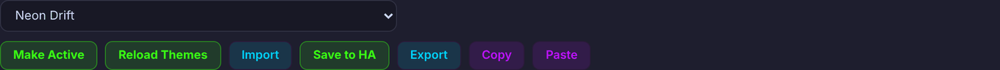
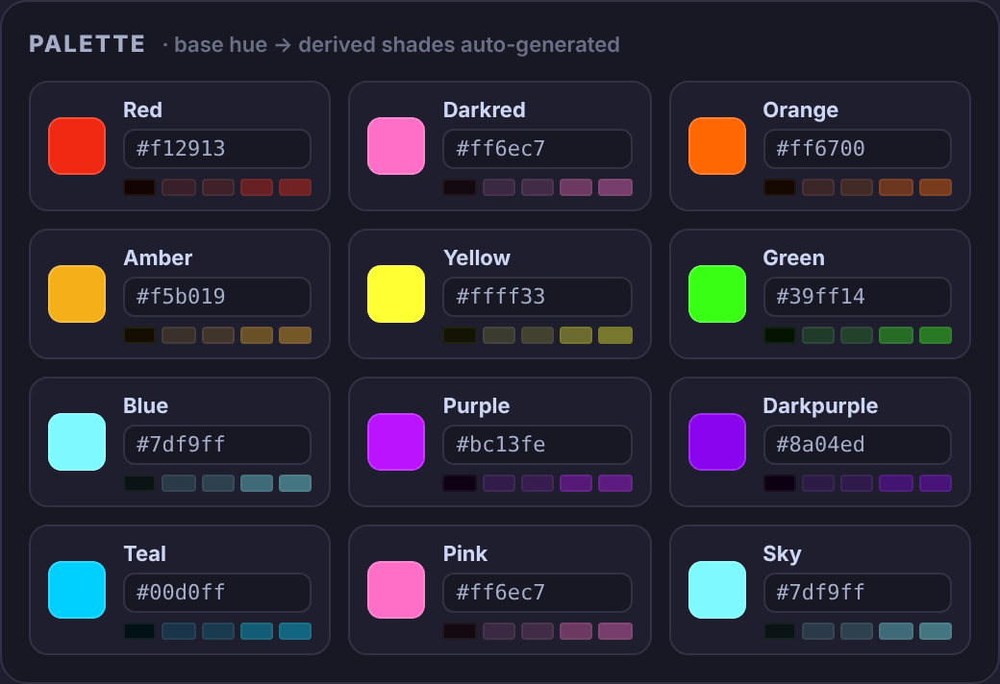
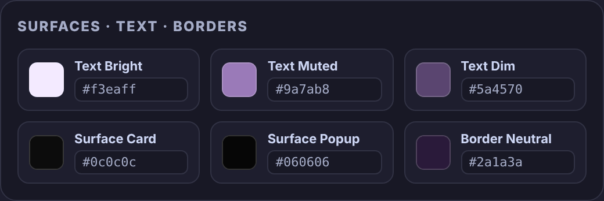
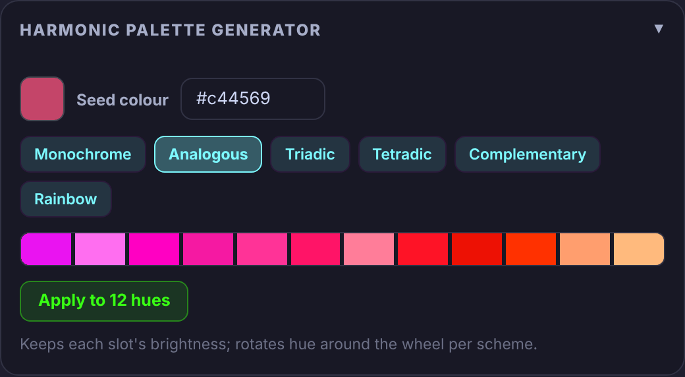
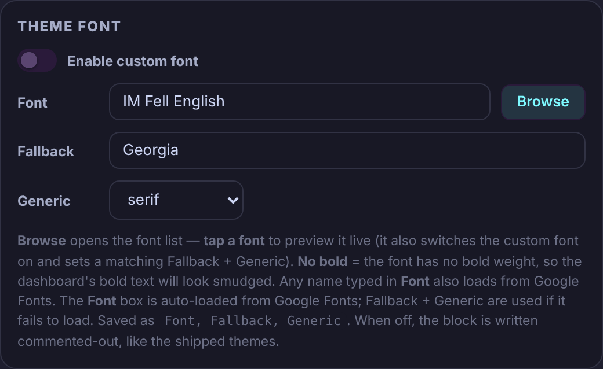
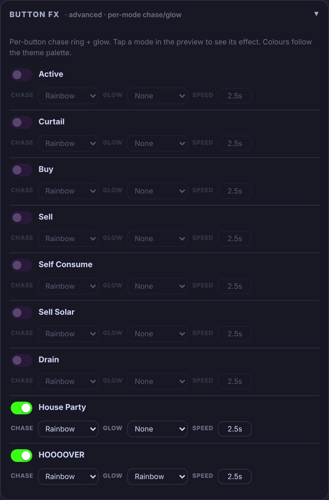
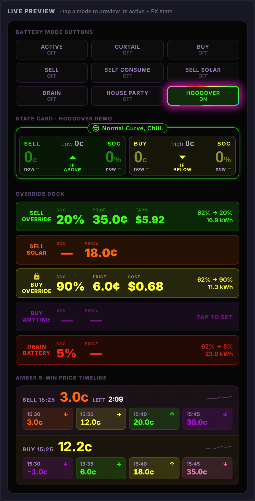
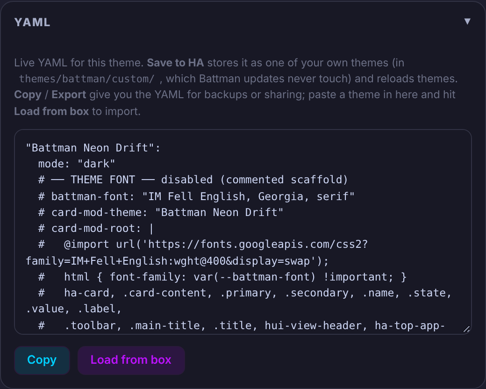

# Theme

The **Theme** view on the Battman dashboard holds Theme Studio: pick a Battman theme, change its colours, font and button effects with a live preview, then save it to Home Assistant as one of your own themes or put it on the dashboard. Its parts are below, in the order the card shows them.

The studio itself takes its colours from the theme you're editing, so the whole card changes as you edit.

While **Show help** is on (see [Showing or hiding the guide](../README.md#showing-or-hiding-the-guide)), a **Help** button at the top right of the view puts a "?" on each part. The "?" opens that part's summary from this page.

| Part | What it is for |
|---|---|
| [Themes](#themes) | The theme picker, and the buttons that save, share and apply a theme. |
| [Palette](#palette) | The twelve colour slots. Each base colour makes its own shades. |
| [Surfaces · Text · Borders](#surfaces) | The text, card, popup and border colours. |
| [Harmonic palette generator](#harmonic) | Twelve new base colours from one seed colour. |
| [Theme font](#font) | A font for the whole dashboard, from Google Fonts. |
| [Button FX](#fx) | The moving ring and glow on each lit mode button. |
| [Live preview](#preview) | Battman's own buttons and cards drawn in the theme you're editing. |
| [YAML](#yaml) | The theme as text, to copy, or to paste a theme in. |

## Themes

<!-- guide:summary id="theme.themes" -->
Pick the theme to edit. **Save to HA** stores it as one of your own themes, **Make Active** puts the saved theme on every view of this dashboard, and **Import**, **Export**, **Copy** and **Paste** move a theme in and out as YAML.
<!-- /guide:summary -->

### The picker

It lists the themes Home Assistant has whose name starts with "Battman", without "Battman" in front: the ones Battman ships and the ones you saved. If none show, see [Battman's themes aren't loaded](../help/repairs.md#themes-not-loaded).

The studio opens on Home Assistant's own theme when that's a Battman one; otherwise on the theme you last edited in this browser, then **Neon Drift**. Choosing a theme loads it. If you have unsaved edits it asks first: "You have unsaved edits to “…”. Discard them and load “…”?". A theme you've imported but not saved shows with "(unsaved)" after its name.

### The buttons

| Button | What it does |
|---|---|
| **Make Active** | Puts the theme chosen in the picker on every view of the dashboard you're on, saves the dashboard and redraws it: "applied". It also sets Battman's **Dashboard theme** (see [Dashboard options](settings.md#dashboard)). Home Assistant's own theme and your other dashboards don't change. |
| **Reload Themes** | Makes Home Assistant read its themes folder again, then refreshes the picker: "Themes reloaded — refreshing list…". For a theme file you put there yourself; **Save to HA** reloads on its own. |
| **Import** | Loads a theme `.yaml` file from your device into the studio, in place of what's there: "imported “…”". It isn't saved. |
| **Save to HA** | Asks for the name, then writes the theme to `themes/battman/custom/Battman <name>.yaml` in your Home Assistant configuration folder and reloads themes: "saved “…” — themes reloaded". |
| **Export** | Asks for the name, then downloads the theme as `Battman <name>.yaml`. |
| **Copy** | Asks for the name, copies the theme's YAML to the clipboard ("copied “…”") and opens the [YAML](#yaml) panel. |
| **Paste** | Loads a theme from the clipboard, like **Import**. If the clipboard can't be read, it opens the YAML box: "paste your theme YAML into the box, then Load from box". |

> [!NOTE]
> **Make Active** uses the theme as Home Assistant has it saved. To see your edits on the dashboard, **Save to HA** first.

### Names and saving

The name prompt reads "Theme name — the key HA uses (“Battman ” is added automatically):". Type the name without "Battman"; letters, numbers, spaces, `-` and `_`, up to 48 characters, starting with a letter or number.

| Message | Meaning |
|---|---|
| "You already have a theme called “…”. Replace it with this version?" | One of your themes has that name. **OK** replaces it. |
| "“…” is a theme Battman ships. Pick another name for your own theme." | Battman's own themes can't be saved over. Save your version under a new name. |
| "Only an administrator can save themes." | Saving needs a Home Assistant administrator. |

Battman's updates and removing Battman leave `themes/battman/custom/` as it is.

## Palette

<!-- guide:summary id="theme.palette" -->
The twelve colour slots Battman's cards use: red, darkred, orange, amber, yellow, green, blue, purple, darkpurple, teal, pink and sky. Change a base colour with its picker or hex box, and its shades are made again from it.
<!-- /guide:summary -->

### Base colour

Tap the swatch for a colour picker, or type `#rrggbb` (or `#rgb`) in the hex box. The strip under each slot shows its `-bg`, `-soft-bg`, `-border-soft`, `-border` and `-border-strong` shades.

### Derived shades

Each slot has seven shades, made from its base colour:

| Shade | Made as |
|---|---|
| `-wash`, `-soft-bg`, `-border-soft`, `-border-light`, `-border`, `-border-strong` | The base colour, see-through. Each keeps the transparency it had in the theme you loaded, or 0.06, 0.13, 0.16, 0.30, 0.35 and 0.40 if it had none. |
| `-bg` | The base colour darkened: its red, green and blue are scaled by the same amount as in the theme you loaded, or to 0.086 of the base if it had none. |

## Surfaces · Text · Borders

<!-- guide:summary id="theme.surfaces" -->
The colours that aren't part of the palette: **Text bright**, **Text muted**, **Text dim**, **Surface card**, **Surface popup** and **Border neutral**. Change each with its swatch or hex box.
<!-- /guide:summary -->

### What isn't here

These have no shades. The theme's `battman-border-neutral-soft`, `mode` and Home Assistant colours (`primary-color`, `accent-color`, the text, divider and background colours) aren't edited here; the studio writes them back as they were.

## Harmonic palette generator

<!-- guide:summary id="theme.harmonic" -->
Makes twelve new base colours from one **Seed colour** and a scheme, shown in a strip. Nothing changes until you press **Apply to 12 hues**, which puts them in the Palette slots and makes their shades again.
<!-- /guide:summary -->

### Schemes

The twelve slots, in Palette order, get hues spread evenly across an arc of the colour wheel centred on the seed's hue:

| Scheme | Arc |
|---|---|
| **Monochrome** | 0° (every slot takes the seed's hue) |
| **Analogous** | 90° |
| **Triadic** | 240° |
| **Tetradic** | 270° |
| **Complementary** | 180° |
| **Rainbow** | 330° |

Only the seed's hue is used. Each slot keeps its own saturation and lightness, so dark slots stay dark and light ones stay light.

## Theme font

<!-- guide:summary id="theme.font" -->
With **Enable custom font** on, the theme sets one font for the dashboard, loaded from Google Fonts, with a **Fallback** and **Generic** font if it doesn't load. **Browse** opens a list of fonts to try in the preview.
<!-- /guide:summary -->

### Choosing a font

**Browse** opens the list (it becomes **Done**), with **Search fonts…** and the groups **All**, **Sans**, **Serif**, **Display**, **Handwriting** and **Mono**. Tapping a font puts it in **Font**, switches the custom font on and sets a **Fallback** and **Generic** to match its group. "no bold" means the font has no bold weight, so bold text is faked. A name that isn't in the list can be typed in **Font**, or picked from "Try “…” from Google Fonts" under a search. **Generic** is one of (none), sans-serif, serif, monospace, system-ui or cursive.

The font shows in the [Live preview](#preview); the studio's own text keeps the dashboard's font.

### What it writes

| Key | Value |
|---|---|
| `battman-font` | `Font, Fallback, Generic`. |
| `card-mod-root` | Loads the font from Google Fonts and puts it on the page, the cards, their headings and dialogs. |
| `card-mod-theme` | The theme's name. |
| `primary-font-family` and Home Assistant's other font settings | The custom font. |

With the switch off, these lines are written commented out.

## Button FX

<!-- guide:summary id="theme.fx" -->
A moving ring and a glow for the lit button of each battery mode, from **Active** to **HOOOOVER**. Each mode has its own switch, **Chase** colour, **Glow** and **Speed**. Tap a mode in the Live preview to see its effect.
<!-- /guide:summary -->

### Each mode's settings

| Setting | What it sets |
|---|---|
| Switch | Turns the effect on or off for that mode. |
| **Chase** | The ring's colour: **Rainbow**, or one of the twelve Palette slots. |
| **Glow** | **None**, **Rainbow**, or one Palette slot. |
| **Speed** | How long one turn of the ring takes, such as `2.5s` (the starting value). |

The colours point at the Palette slots, so they follow your Palette changes.

## Live preview

<!-- guide:summary id="theme.preview" -->
Battman's own Power-view pieces drawn in the theme you're editing, with made-up values: the battery mode buttons, the State card, the override rows and the Amber prices. Every edit shows straight away; the dashboard doesn't change.
<!-- /guide:summary -->

### What it shows

| Section | Shows |
|---|---|
| **Battery mode buttons** | The nine mode buttons. Tap one to light it and see its [Button FX](#fx). **HOOOOVER** is lit to begin with. |
| **State card · HOOOOVER demo** | Battman's State card, read from Battman, as it looks during a HOOOOVER. |
| **Override dock** | The five override rows with sample levels and prices. |
| **Amber 5-min price timeline** | Sample **SELL** and **BUY** prices, coloured by price band, with the **LEFT** countdown. |

### The note beside the title

It says where the theme stands: "· unsaved edits" after a change, then "· saved “…”", "· exported “…”", "· copied “…”" or "· imported “…”".

## YAML

<!-- guide:summary id="theme.yaml" -->
The theme being edited, as YAML, kept up to date with every change. **Copy** copies it; paste a theme into the box and press **Load from box** to load it into the studio.
<!-- /guide:summary -->

### Copy and Load from box

**Copy** here copies the box as it is, without asking for a name. **Load from box** reads a theme from the box in place of the one in the studio, like **Import**; "couldn't parse that YAML" means it found no theme there. A pasted theme whose name doesn't start with "Battman " gets it added. While you're typing in the box, edits elsewhere don't overwrite it.
